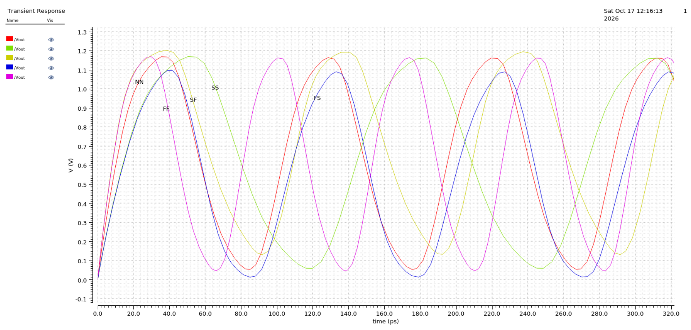
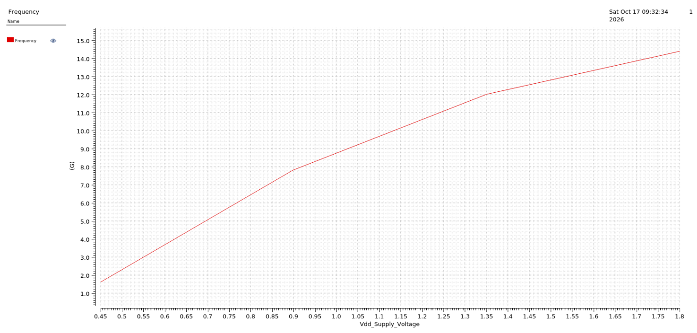
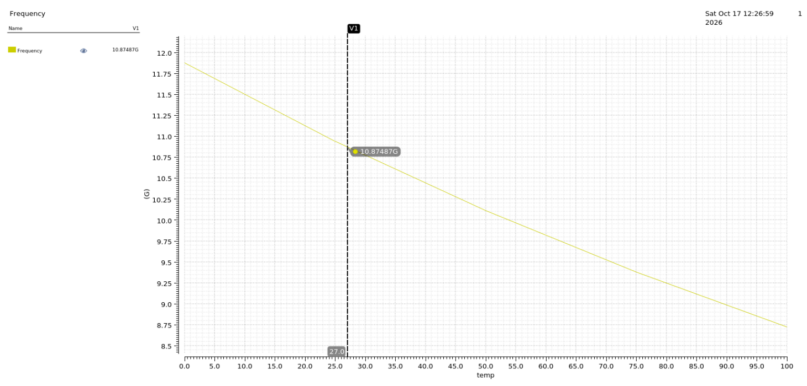

# PVT Analysis (post-layout)

## Process corners (Vdd = 1.2 V, 27°C)

| Corner | Freq. (GHz) | vs NN | Power (µW) | Energy (fJ) |
|---|---|---|---|---|
| FF | 13.84 | +27.3% | 238.0 | 17.2 |
| NN | 10.87 | n/a | 180.1 | 16.6 |
| FS | 10.75 | -1.1% | 173.5 | 16.1 |
| SF | 10.01 | -7.9% | 163.5 | 16.3 |
| SS | 7.75 | -28.7% | 124.1 | 16.0 |

The oscillator starts in all five corners. Even FF is about 8% below the 15 GHz target, and SS is about 48% below it.

## Supply voltage (NN, 27°C)

Oscillates down to 0.45 V (about 1.6 GHz). Frequency is about 7.8 GHz at 0.9 V, 12.0 GHz at 1.35 V and 14.4 GHz at 1.8 V. The slope is about 9.3 GHz/V from 0.9 to 1.35 V and about 5.3 GHz/V above 1.35 V.

## Temperature (NN, Vdd = 1.2 V)

Frequency falls from about 11.9 GHz at 0°C to 10.87 GHz at 27°C and about 8.7 GHz at 100°C (about 27% drop, roughly 32 MHz/°C), because carrier mobility decreases at high temperature.
