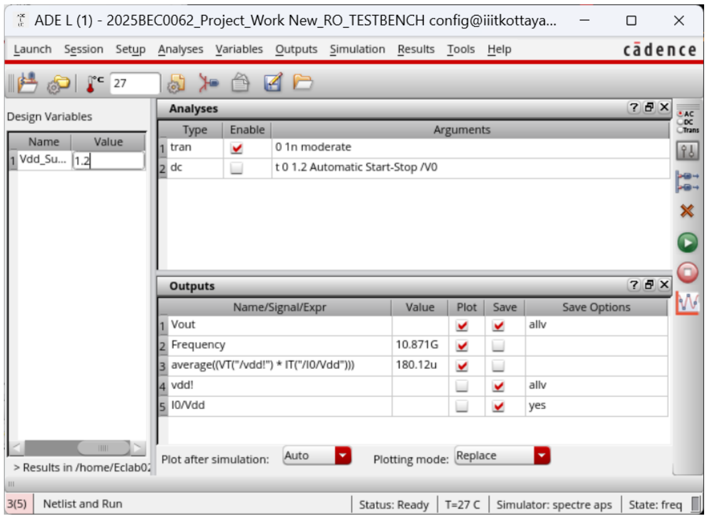
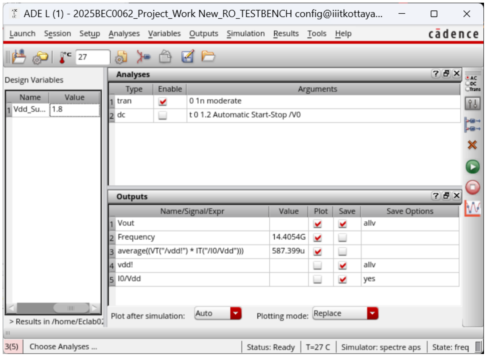

# Post-layout Simulation

Run on the `av_extracted` view (0 to 1 ns, 27°C).

**Vdd = 1.2 V**

**Vdd = 1.8 V** (above the rated supply, trend only)

| Parameter | Pre-layout (1.2 V) | Post-layout (1.2 V) | Post-layout (1.8 V) |
|---|---|---|---|
| Frequency (GHz) | 14.72 | 10.87 | 14.41 |
| Average power (µW) | 182.5 | 180.12 | 587.4 |
| Energy per cycle (fJ) | 12.4 | 16.6 | 40.8 |

- Post-layout frequency is 0.74 of the schematic value (a drop of about 26%), caused by wiring capacitance. This gives Cpar of about 0.35 C.
- At 1.8 V the frequency recovers to 96% of the target, but at about 3.3 times the power.
- The 15 GHz target is not met after layout at any valid supply. Shorter routes, tighter placement or re-tuned sizes are needed.
