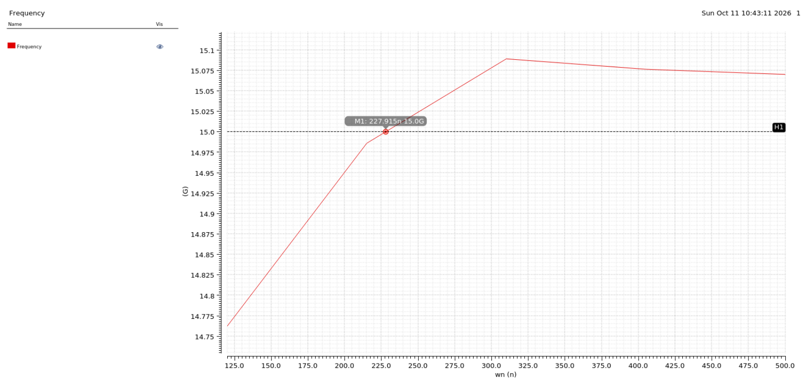
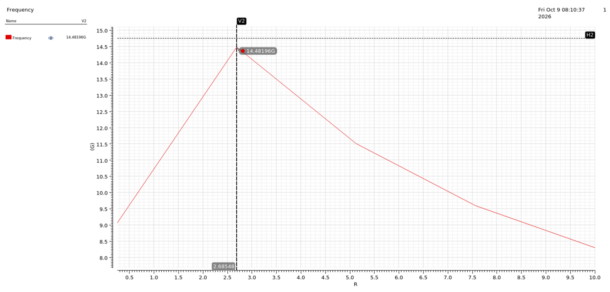
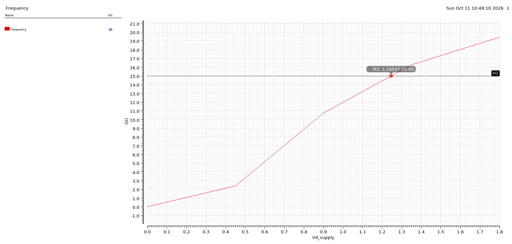
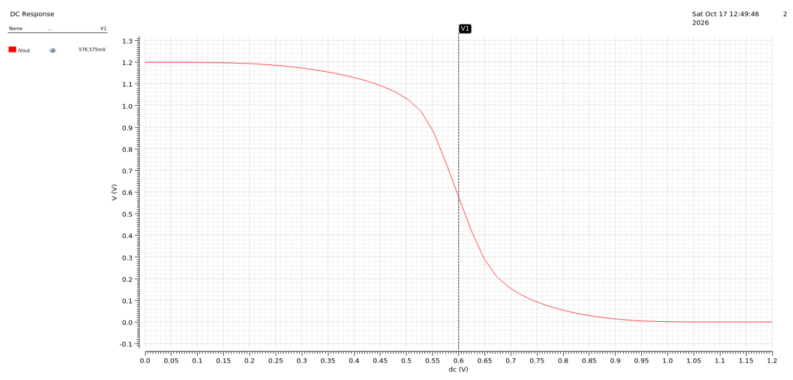

# Pre-layout Simulation

## Parameter sweeps
**Frequency vs Wn** (nearly flat; Wn = 228 nm for 15 GHz)

**Frequency vs R** (peak 14.48 GHz at R = 2.7, so Wp is about 615.6 nm)

**Frequency vs Vdd** (15 GHz at 1.245 V, rounded to nominal 1.2 V)

## Inverter DC transfer characteristic
Trip voltage about 0.60 V, peak gain |A0| about 6.
Loop gain about 216 at DC and about 27 at the oscillation frequency, so the Barkhausen criterion is satisfied.

## Results (27°C, Vdd = 1.2 V)
| Parameter | Value |
|---|---|
| Target frequency | 15 GHz |
| Calculated frequency | 14.66 GHz |
| Simulated frequency | 14.72 GHz |
| Average power | 182.5 µW |
| Energy per cycle | 12.4 fJ |
| Phase shift per stage (calculated) | 60° |
| Phase shift per stage (simulated) | 60.2° |
