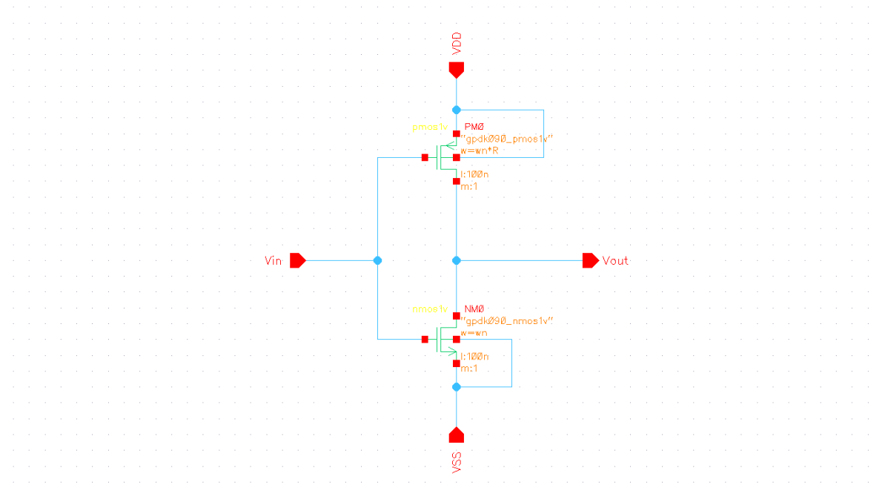
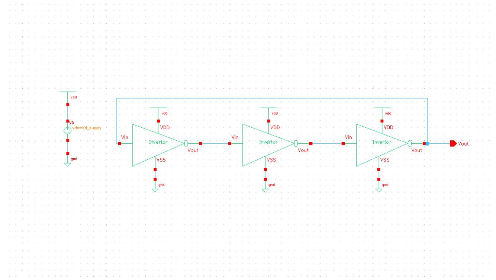
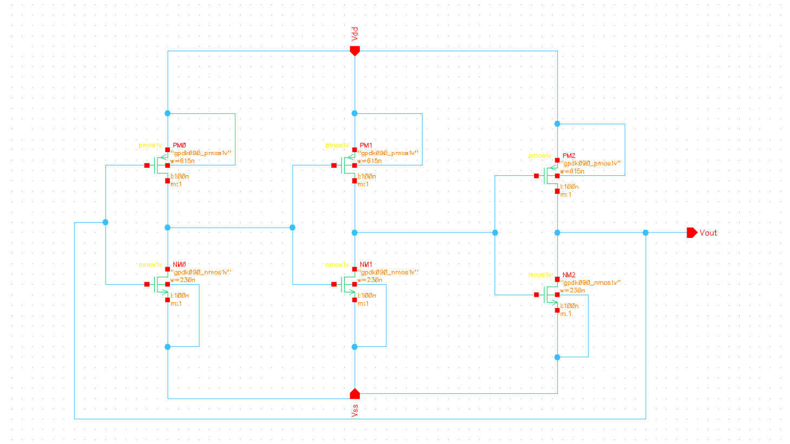

# Schematic

Transistor-level design of the 3-stage ring oscillator (GPDK 90 nm).
Wn = 230 nm, Wp = 615 nm (R = 2.7), L = 100 nm, Vdd = 1.2 V, N = 3.

**CMOS inverter (one stage)**

**3-stage ring oscillator (block level)**

**Final transistor-level schematic**

The output of the third inverter feeds the input of the first. There is no input signal.
