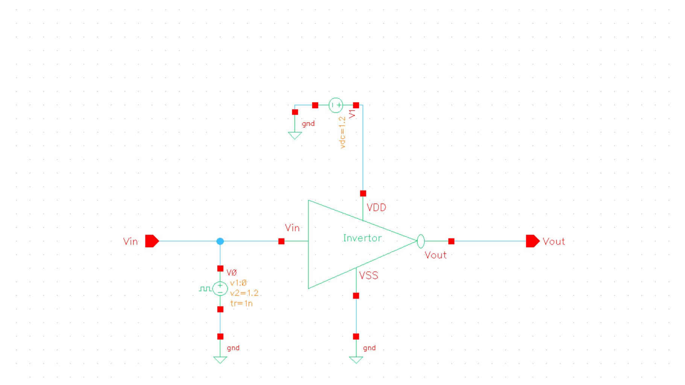
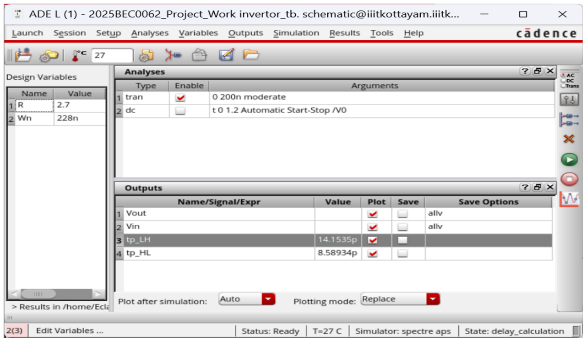
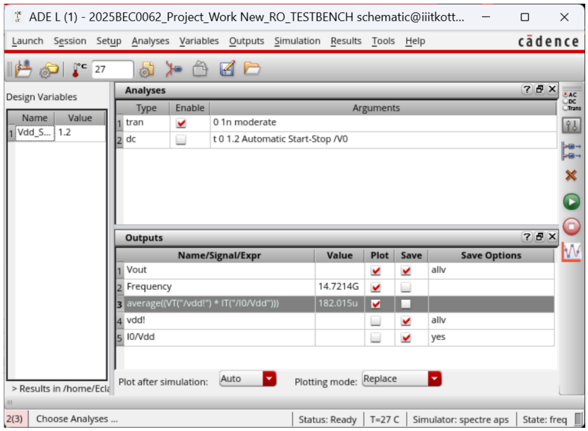

# Testbench

**Inverter testbench** (pulse 0 to 1.2 V, tr = 1 ns, Vdd = 1.2 V, tran 0 to 200 ns)

**Inverter ADE setup and measured delays**

| Parameter | Value |
|---|---|
| tpHL | 8.589 ps |
| tpLH | 14.154 ps |
| tp = (tpHL + tpLH)/2 | 11.37 ps |
| f = 1/(2 N tp), N = 3 | 14.66 GHz |

**Ring oscillator ADE setup (pre-layout)**

The initial condition Vout = 0 is set under ADE-L → Simulation → Convergence Aids → Initial Condition to start the oscillation.
