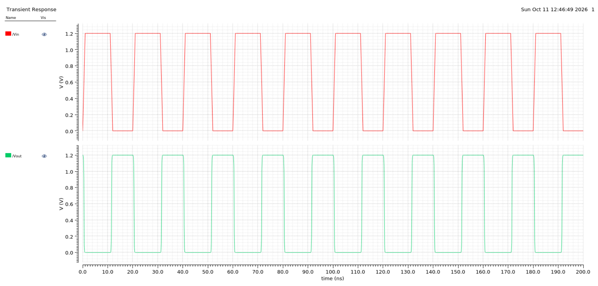
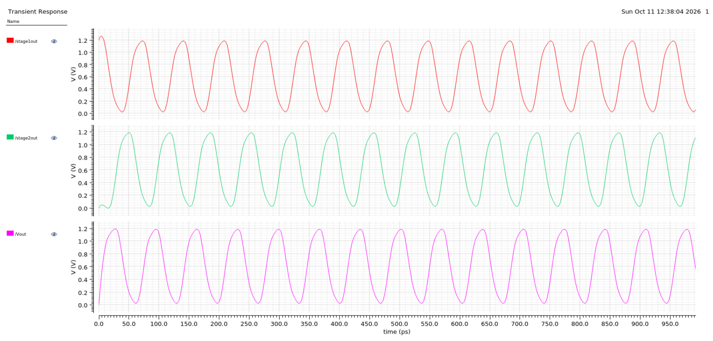
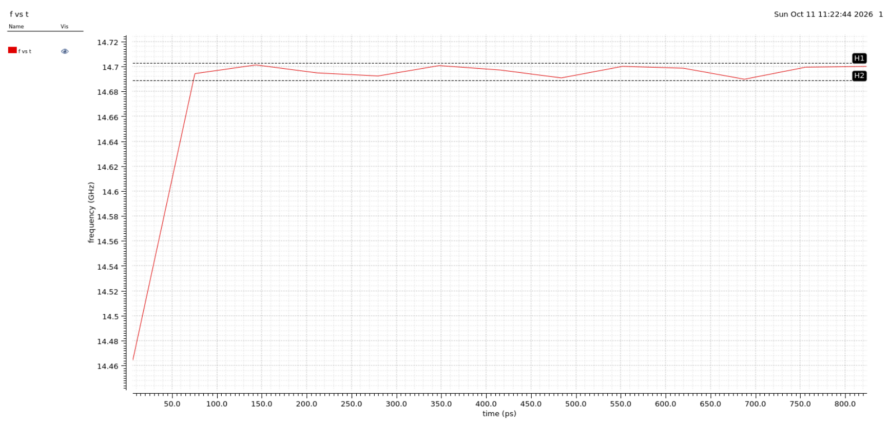
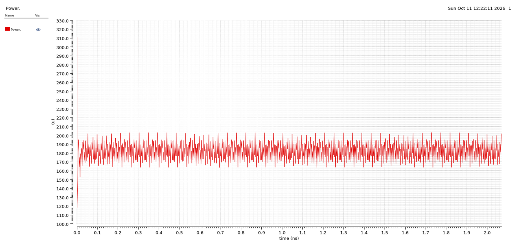
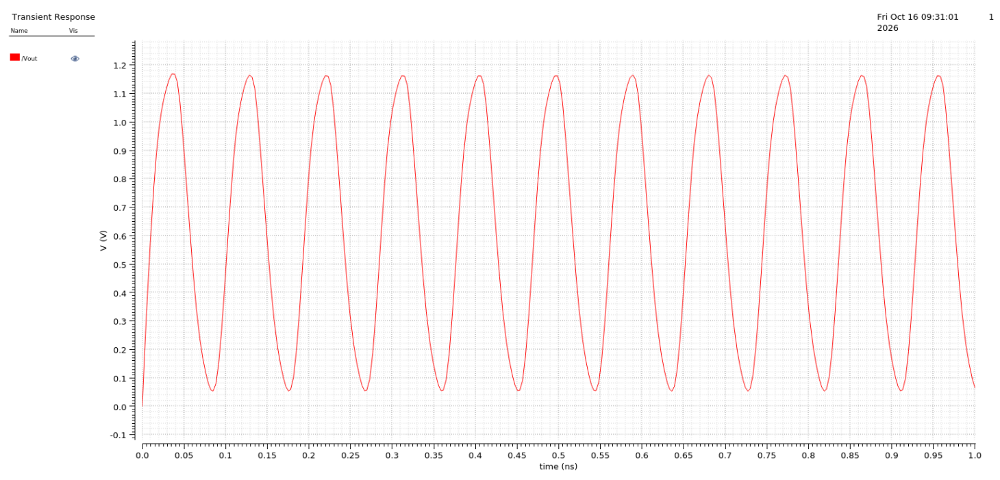

# Waveforms

**Inverter input and output** (Fig 3.2)

**Output of each stage, pre-layout, 27°C** (Fig 4.3)

**Frequency vs time**: rises from 14.46 to 14.69 GHz in about 75 ps, then stays between 14.69 and 14.72 GHz (Fig 4.5)

**Instantaneous power**: start-up peak about 310 µW, then 165 to 203 µW (Fig 4.6)

**Post-layout output, 1.2 V** (Fig 6.2)

